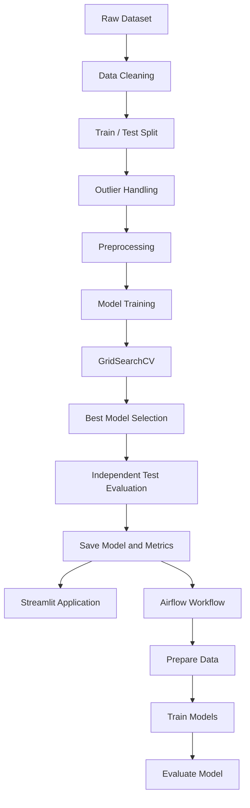

# Jury Blanc — Student Mental Health Risk Prediction

<p align="center">
  <strong>An End-to-End Data Science & Machine Learning Project</strong>
  <br>
  Exploring student well-being data through EDA, preprocessing, model optimization, workflow orchestration, and an interactive application.
</p>

<p align="center">
  
  
  
  
  
  
</p>

---

## Table of Contents

- [Overview](#-overview)
- [Important Notice](#-important-notice)
- [Project Objectives](#-project-objectives)
- [Dataset](#-dataset)
- [Project Workflow](#-project-workflow)
- [Machine Learning Pipeline](#-machine-learning-pipeline)
- [Model Training and Results](#-model-training-and-results)
- [Project Architecture](#-project-architecture)
- [Technologies Used](#-technologies-used)
- [Getting Started](#-getting-started)
  - [Prerequisites](#1-prerequisites)
  - [Clone the Repository](#2-clone-the-repository)
  - [Download the Dataset](#3-download-the-dataset)
  - [Install Dependencies](#4-install-dependencies)
  - [Run the Machine Learning Pipeline](#5-run-the-machine-learning-pipeline)
- [Run the Streamlit Application](#-run-the-streamlit-application)
- [Run Apache Airflow with Docker](#-run-apache-airflow-with-docker)
- [Project Commands Cheat Sheet](#-project-commands-cheat-sheet)
- [Configuration](#-configuration)
- [Reproducibility](#-reproducibility)
- [Limitations and Future Improvements](#-limitations-and-future-improvements)
- [Author](#-author)

---

## Overview

**Jury Blanc — Student Mental Health Risk Prediction** is an end-to-end Data Science and Machine Learning project developed to explore factors associated with student well-being and build a supervised classification prototype.

The project uses student-related information, including academic performance, lifestyle habits, social media usage, financial stress, family support, and previous mental health history, to classify observations into three risk categories:

- **Low**
- **Medium**
- **High**

The main objective is to demonstrate a complete Machine Learning workflow, from raw data analysis to model deployment and workflow automation.

Unlike a simple model-training notebook, this project integrates several stages of a real-world Data Science workflow:

- Exploratory Data Analysis (EDA).
- Data cleaning and preprocessing.
- Feature transformation.
- Model training and comparison.
- Hyperparameter optimization.
- Independent test evaluation.
- Model serialization.
- Workflow orchestration with Apache Airflow.
- Interactive model exploration with Streamlit.

The project was developed as an individual educational project for the **Jury Blanc**.

## Important Notice

**This project is strictly educational and experimental.**

The predictions generated by this application are not medical diagnoses, clinical assessments, or reliable measurements of an individual's mental health.

The model must never be used for:

- Clinical diagnosis or medical screening.
- Disciplinary decisions.
- Student admission or selection.
- Academic evaluation.
- Any decision that could negatively affect a student.

Its purpose is to demonstrate Machine Learning techniques and explore patterns in a dataset. It does not replace qualified mental health professionals.

---

## Project Objectives

The project aims to cover the complete Data Science lifecycle.

| Area | Objectives |
|---|---|
| Data Analysis | Understand the dataset, distributions, missing values, correlations, and relationships. |
| Data Cleaning | Handle missing values, duplicates, and inconsistent observations. |
| Preprocessing | Encode categorical variables, handle outliers, and scale numerical features. |
| Machine Learning | Train and compare at least three classification algorithms. |
| Optimization | Use GridSearchCV to find better hyperparameters. |
| Evaluation | Measure model performance on an independent test set. |
| Serialization | Save the trained model and preprocessing pipeline. |
| Automation | Orchestrate the workflow using Apache Airflow. |
| Visualization | Build an interactive Streamlit application. |

---

## Dataset

The project uses the following Kaggle dataset:

**Mental Health Risk Prediction Dataset — Students**

Source: [Kaggle Dataset](https://www.kaggle.com/datasets/maqdadali/mental-health-risk-prediction-dataset-students)

### Dataset Overview

| Property | Value |
|---|---|
| Number of observations | 2,000 |
| Number of original columns | 17 |
| Target variable | `Mental_Health_Risk` |
| Classification type | Multiclass classification |
| Number of target classes | 3 |
| Training set | 80% (1,600 observations) |
| Test set | 20% (400 observations) |

### Features

The dataset contains information about different aspects of student life.

| Feature | Description | Type |
|---|---|---|
| `Student_ID` | Student identifier | Identifier |
| `Age` | Student age | Numerical |
| `Gender` | Student gender | Nominal |
| `Year_of_Study` | Current year of study | Numerical |
| `Sleep_Hours` | Daily sleep duration | Numerical |
| `Study_Hours_Per_Week` | Weekly study duration | Numerical |
| `GPA` | Grade Point Average | Numerical |
| `Social_Media_Hours` | Daily social media usage | Numerical |
| `Screen_Time_Hours` | Daily screen time | Numerical |
| `Financial_Stress` | Financial stress level | Numerical |
| `Family_Support` | Family support level | Numerical |
| `Attendance_Rate` | Attendance percentage | Numerical |
| `Part_Time_Job` | Whether the student has a part-time job | Nominal |
| `Previous_Mental_Health_History` | Previous mental health history | Nominal |
| `Physical_Activity` | Physical activity level | Ordinal |
| `Diet_Quality` | Diet quality | Ordinal |
| `Mental_Health_Risk` | Target classification | Target |

`Student_ID` is an identifier and is removed before model training.

### Target Distribution

The target variable contains three classes:

| Class | Number of observations |
|---|---:|
| Low | 660 |
| Medium | 660 |
| High | 680 |
| **Total** | **2,000** |

The classes are relatively balanced. Therefore, SMOTE was not required for this experiment.

---

## Project Workflow

The project follows five main stages.

### 1. Exploratory Data Analysis (EDA)

The first notebook investigates the structure and quality of the dataset.

Main activities:

- Inspect dataset dimensions and data types.
- Examine descriptive statistics.
- Identify missing values.
- Check duplicate observations.
- Investigate inconsistent values.
- Analyze numerical distributions.
- Explore categorical variables.
- Examine relationships between features and the target.
- Analyze correlations.

Notebook: `notebooks/01_EDA.ipynb`

### 2. Data Cleaning and Preprocessing

The second notebook prepares the dataset for Machine Learning.

Main activities:

1. Remove the `Student_ID` identifier.
2. Correct inconsistent social media usage values.
3. Split the data into training and testing sets.
4. Detect and handle outliers using the IQR method.
5. Impute missing numerical values.
6. Impute missing categorical values.
7. Encode nominal and ordinal variables.
8. Standardize numerical features.
9. Organize transformations using Scikit-learn Pipelines and ColumnTransformer.

**Train/Test Split**

The dataset is divided using:

- Training set: 80%.
- Testing set: 20%.
- `random_state=42`.
- Stratified splitting to preserve class proportions.

**Missing Values**

Different imputation strategies are used according to the feature type:

| Feature Type | Imputation Strategy |
|---|---|
| Numerical | Mean |
| Nominal | Most frequent |
| Ordinal | Most frequent |

**Outlier Handling**

The Interquartile Range (IQR) method is used:

\[
IQR = Q3 - Q1
\]

\[
Lower = Q1 - 1.5 \times IQR
\]

\[
Upper = Q3 + 1.5 \times IQR
\]

Outlier boundaries are calculated from the training set and then applied to both training and testing data.

**Categorical Encoding**

- Nominal variables: `OneHotEncoder`.
- Ordinal variables: `OrdinalEncoder`.

Ordinal categories preserve their natural order:

- `Physical_Activity`: Low < Moderate < High.
- `Diet_Quality`: Poor < Average < Good.

**Numerical Scaling**

`StandardScaler` is used to standardize numerical features.

The preprocessing transformations are organized with `Pipeline` and `ColumnTransformer` to help prevent data leakage during model fitting and evaluation.

Notebook: `notebooks/02_Cleaning_Preprocessing.ipynb`

### 3. Model Training and Comparison

Three classification algorithms are trained using the same training data:

1. Logistic Regression.
2. Random Forest Classifier.
3. K-Nearest Neighbors (KNN).

The models are compared using:

- Accuracy.
- Precision.
- Recall.
- F1-score.
- ROC-AUC.
- Confusion Matrix.

Notebook: `notebooks/03_Model_Training.ipynb`

### 4. Hyperparameter Optimization and Evaluation

`GridSearchCV` is used to optimize the models.

The optimization process uses:

- 5-fold cross-validation.
- Weighted F1-score as the scoring metric.
- `n_jobs=-1` to use available CPU cores.

The optimized models are compared, and the selected model is evaluated on the independent test set.

The complete preprocessing and classification pipeline is serialized using Joblib.

Notebook: `notebooks/04_Model_Optimization.ipynb`

### 5. Workflow Automation and Interactive Application

**Apache Airflow**

An Airflow DAG orchestrates the main Machine Learning workflow:

1. `prepare_data`
2. `train`
3. `evaluate`

The tasks execute sequentially, with dependencies defined between them.

The DAG also supports scheduled execution and monitoring through the Airflow interface.

**Streamlit**

The interactive application provides:

- Model performance metrics.
- Classification report.
- Confusion matrix.
- A form to enter new student-related observations.
- Model predictions.
- Prediction probabilities for the three classes.

The Streamlit application loads the saved model and evaluation reports.

---

## Machine Learning Pipeline

The following diagram illustrates the overall architecture:



### Preprocessing Architecture

The preprocessing stage uses three separate pipelines.

| Pipeline | Operations |
|---|---|
| Numerical | Mean Imputation → StandardScaler |
| Nominal | Most Frequent Imputation → OneHotEncoder |
| Ordinal | Most Frequent Imputation → OrdinalEncoder |

These pipelines are combined using `ColumnTransformer`.

After preprocessing, the training dataset contains **19 transformed features**.

---

## Model Training and Results

### Initial Model Comparison

The following results were obtained during the initial model comparison.

| Model | Accuracy | Weighted Precision | Weighted Recall | Weighted F1 | ROC-AUC |
|---|---:|---:|---:|---:|---:|
| Logistic Regression | 0.7600 | 0.7596 | 0.7600 | 0.7598 | 0.9143 |
| Random Forest | 0.7075 | 0.7006 | 0.7075 | 0.7028 | 0.8565 |
| KNN | 0.5900 | 0.5799 | 0.5900 | 0.5836 | 0.7611 |

Logistic Regression achieved the strongest initial results and was selected for further optimization.

### GridSearchCV Results

| Model | Best Parameters | Best Cross-Validation Weighted F1 |
|---|---|---:|
| Logistic Regression | `C=1` | 0.7459 |
| Random Forest | `max_depth=None`, `min_samples_split=2`, `n_estimators=300` | 0.6828 |
| KNN | `n_neighbors=7`, `weights='distance'` | 0.6424 |

### Final Test Evaluation

The selected Logistic Regression model achieved the following results on the independent test set:

| Metric | Score |
|---|---:|
| Accuracy | 0.7600 |
| Weighted Precision | 0.7596 |
| Weighted Recall | 0.7600 |
| Weighted F1-score | 0.7598 |
| ROC-AUC | 0.9143 |

### Classification Report

| Class | Precision | Recall | F1-score | Support |
|---|---:|---:|---:|---:|
| Low | 0.82 | 0.81 | 0.82 | 132 |
| Medium | 0.64 | 0.64 | 0.64 | 132 |
| High | 0.81 | 0.83 | 0.82 | 136 |

### Confusion Matrix

| Actual / Predicted | Low | Medium | High |
|---|---:|---:|---:|
| Low | 108 | 23 | 1 |
| Medium | 23 | 84 | 25 |
| High | 0 | 23 | 113 |

### Error Analysis

The Medium class is the most difficult class for the selected model.

| Class | Error Rate |
|---|---:|
| Low | 18.18% |
| Medium | 36.36% |
| High | 16.91% |

This indicates that the model has more difficulty distinguishing Medium observations from the other categories.

**Important:** These metrics describe performance on this specific dataset and test split. They do not establish clinical validity, fairness, or suitability for real-world mental health decisions.

---

## Project Architecture

```text
Jury-Blanc/
│
├── data/
│   ├── raw/
│   │   └── student_mental_health.csv
│   │
│   └── processed/
│       ├── df_clean.csv
│       ├── train_data.joblib
│       └── test_data.joblib
│
├── notebooks/
│   ├── 01_EDA.ipynb
│   ├── 02_Cleaning_Preprocessing.ipynb
│   ├── 03_Model_Training.ipynb
│   └── 04_Model_Optimization.ipynb
│
├── src/
│   ├── __init__.py
│   ├── config.py
│   ├── cleaning.py
│   ├── preprocessing.py
│   ├── training.py
│   ├── evaluation.py
│   └── main.py
│
├── dags/
│   └── student_mental_health_dag.py
│
├── models/
│   └── best_model_pipeline.joblib
│
├── reports/
│   ├── metrics.json
│   └── confusion_matrix.png
│
├── app/
│   └── app.py
│
├── logs/
│
├── Dockerfile
├── docker-compose.yml
├── docker.env
├── requirements.txt
├── pyproject.toml
├── uv.lock
└── README.md
```

### Main Source Files

| File | Responsibility |
|---|---|
| `config.py` | Centralizes project paths and configuration. |
| `cleaning.py` | Loads and cleans the raw dataset. |
| `preprocessing.py` | Defines outlier handling and preprocessing pipelines. |
| `training.py` | Trains, compares, and optimizes classification models. |
| `evaluation.py` | Evaluates the selected model and saves reports. |
| `main.py` | Coordinates the complete Machine Learning workflow. |
| `student_mental_health_dag.py` | Defines the Airflow DAG and its tasks. |
| `app.py` | Implements the interactive Streamlit application. |

---

## Technologies Used

### Programming and Data Science

- **Python** — Main programming language.
- **Pandas** — Data manipulation and analysis.
- **NumPy** — Numerical operations.
- **Scikit-learn** — Preprocessing, classification, optimization, and evaluation.
- **Joblib** — Model serialization.
- **Matplotlib** — Data visualization and confusion matrix generation.

### Workflow Automation and Deployment

- **Apache Airflow 2.9.2** — Workflow orchestration and scheduling.
- **Docker** — Containerization.
- **Docker Compose** — Multi-container management.
- **Streamlit** — Interactive web application.
- **uv** — Python dependency and project management.

---

# Getting Started

Follow these instructions to clone, configure, and run the project on your local machine.

## 1. Prerequisites

Install the following tools before starting:

| Tool | Purpose |
|---|---|
| Git | Clone the repository |
| Python 3.10+ | Run the Machine Learning project |
| uv | Manage Python dependencies |
| Docker Desktop | Run Airflow containers |
| Docker Compose | Manage Docker services |
| Kaggle Account | Download the dataset |

Useful installation resources:

- [Python](https://www.python.org/downloads/)
- [Git](https://git-scm.com/downloads)
- [uv Installation](https://docs.astral.sh/uv/getting-started/installation/)
- [Docker Desktop](https://www.docker.com/products/docker-desktop/)

**Note:** Docker is required for the Airflow setup. The Machine Learning pipeline and Streamlit application can run locally without Docker.

## 2. Clone the Repository

Open your terminal and execute:

```bash
git clone < https://github.com/ISMAILBENMEZI/student-mental-health-risk-prediction.git >
```

Move into the project directory:

```bash
cd Jury-Blanc
```

Replace the GitHub URL with the actual repository URL.

## 3. Download the Dataset

The dataset is hosted on Kaggle.

Download it from:

[Student Mental Health Risk Prediction Dataset](https://www.kaggle.com/datasets/maqdadali/mental-health-risk-prediction-dataset-students)

After downloading, extract the CSV file and place it inside:

```text
data/raw/student_mental_health.csv
```

The expected path is:

```text
Jury-Blanc/
└── data/
    └── raw/
        └── student_mental_health.csv
```

The dataset is not automatically downloaded by the application. Make sure the file is available before running the pipeline.

## 4. Install Dependencies

The project uses `uv` for dependency management.

Synchronize the project environment using:

```bash
uv sync
```

This command creates or synchronizes the virtual environment and installs the dependencies defined by the project configuration and lock file.

Check the Python version:

```bash
uv run python --version
```

Check the installed Scikit-learn version:

```bash
uv run python -c "import sklearn; print(sklearn.__version__)"
```

The project uses Scikit-learn 1.7.2 for the saved model environment.

## 5. Run the Machine Learning Pipeline

From the root directory, execute:

```bash
uv run python -m src.main
```

This command runs the complete pipeline.

The execution follows these stages:

1. Load and clean the raw dataset.
2. Split the data into training and testing sets.
3. Handle outliers.
4. Train and optimize classification models.
5. Select the best model.
6. Evaluate the selected model.
7. Save the model and evaluation reports.

### Expected Outputs

After successful execution, the project generates or updates:

```text
data/processed/df_clean.csv
data/processed/train_data.joblib
data/processed/test_data.joblib

models/best_model_pipeline.joblib

reports/metrics.json
reports/confusion_matrix.png
```

**Note:** Model optimization uses GridSearchCV with cross-validation, so execution may take some time depending on your hardware.

---

# Run the Streamlit Application

The Streamlit application allows users to explore model performance and test new observations.

From the project root, execute:

```bash
uv run streamlit run app/app.py
```

Streamlit will start a local web server. Open the URL displayed in your terminal, usually:

```text
http://localhost:8501
```

### Application Features

**1. Model Performance Dashboard**

Displays the main evaluation metrics:

- Accuracy.
- Precision.
- Recall.
- F1-score.
- ROC-AUC.

**2. Classification Report**

Displays class-level precision, recall, F1-score, and support.

**3. Confusion Matrix**

Visualizes the relationship between actual and predicted classes.

**4. Test New Data**

Users can enter values for the model input features and request a prediction.

The application displays:

- Predicted class.
- Prediction probabilities for Low, Medium, and High.

**Important:** The model expects the same input feature names and categories used during training. Do not include `Student_ID` in the prediction input.

The saved model and evaluation reports must exist before launching the application.

---

# Run Apache Airflow with Docker

Apache Airflow is used to automate and monitor the Machine Learning workflow.

The project provides:

- `Dockerfile`
- `docker-compose.yml`
- `docker.env`
- `dags/student_mental_health_dag.py`

### 1. Configure Environment Variables

The Docker Compose configuration uses a separate environment file named:

```text
docker.env
```

If the repository provides a template, copy it and adapt its values:

```bash
cp docker.env.example docker.env
```

On Windows PowerShell:

```powershell
Copy-Item docker.env.example docker.env
```

If the template is not included, create `docker.env` using the variables required by `docker-compose.yml`.

**Security:** Never commit real credentials, passwords, or secret keys to GitHub. Keep your personal `docker.env` file local.

### 2. Validate the Docker Compose Configuration

Run:

```bash
docker compose --env-file docker.env config
```

This checks the Compose configuration and environment variables.

### 3. Build the Airflow Docker Image

Run:

```bash
docker compose --env-file docker.env build
```

This builds the required Docker image using the provided Dockerfile.

### 4. Initialize Airflow

Before starting the services for the first time, run:

```bash
docker compose --env-file docker.env up airflow-init
```

Wait until the initialization process completes successfully.

This initializes the Airflow database and prepares the environment.

You normally do not need to repeat this initialization every time you start the project.

### 5. Start Airflow Services

Run:

```bash
docker compose --env-file docker.env up -d
```

This starts the Docker services in detached mode.

Check running containers:

```bash
docker compose --env-file docker.env ps
```

### 6. Access the Airflow Interface

Open:

```text
http://localhost:8081
```

Log in using the Airflow credentials configured in `docker.env`.

### 7. Run the DAG

Inside the Airflow interface:

1. Locate `student_mental_health_pipeline`.
2. Enable the DAG if necessary.
3. Trigger the DAG manually.
4. Open the DAG details.
5. Inspect the task execution status.

The DAG contains three sequential tasks:

```text
prepare_data → train → evaluate
```

Each task must complete successfully before the next one executes.

The DAG is configured with:

```python
schedule="@daily"
catchup=False
```

This means Airflow is configured for daily scheduled runs without automatically backfilling historical scheduled runs.

### 8. Stop Airflow

To stop the containers:

```bash
docker compose --env-file docker.env down
```

To stop the containers and also remove their associated volumes:

```bash
docker compose --env-file docker.env down -v
```

**Warning:** The `-v` option removes Docker volumes, including persisted service data such as the Airflow metadata database. Use it only when you intentionally want to reset the environment.

### 9. Useful Airflow Docker Commands

View service logs:

```bash
docker compose --env-file docker.env logs
```

View logs for the scheduler:

```bash
docker compose --env-file docker.env logs airflow-scheduler
```

View logs for the webserver:

```bash
docker compose --env-file docker.env logs airflow-webserver
```

Follow logs in real time:

```bash
docker compose --env-file docker.env logs -f
```

Restart the services:

```bash
docker compose --env-file docker.env restart
```

Recreate the scheduler and webserver after rebuilding the image:

```bash
docker compose --env-file docker.env up -d --force-recreate airflow-scheduler airflow-webserver
```

---

## Project Commands Cheat Sheet

All commands below assume that the terminal is opened in the project root.

### Local Development

| Task | Command |
|---|---|
| Install dependencies | `uv sync` |
| Check Python version | `uv run python --version` |
| Run the ML pipeline | `uv run python -m src.main` |
| Run Streamlit | `uv run streamlit run app/app.py` |

### Docker and Airflow

| Task | Command |
|---|---|
| Validate Compose | `docker compose --env-file docker.env config` |
| Build images | `docker compose --env-file docker.env build` |
| Initialize Airflow | `docker compose --env-file docker.env up airflow-init` |
| Start services | `docker compose --env-file docker.env up -d` |
| Check containers | `docker compose --env-file docker.env ps` |
| View logs | `docker compose --env-file docker.env logs` |
| Restart services | `docker compose --env-file docker.env restart` |
| Stop services | `docker compose --env-file docker.env down` |
| Stop and remove volumes | `docker compose --env-file docker.env down -v` |

### Git Commands

Check modified files:

```bash
git status
```

Add project files:

```bash
git add .
```

Create a commit:

```bash
git commit -m "Add project documentation and final implementation"
```

Push changes:

```bash
git push origin main
```

---

## Configuration

Project paths and shared settings are centralized in:

```text
src/config.py
```

The configuration includes:

- Project root directory.
- Raw dataset path.
- Cleaned dataset path.
- Target column.
- Model directory.
- Serialized model path.
- Reports directory.
- Metrics and confusion matrix paths.

This approach keeps project paths consistent across the different modules.

---

## Reproducibility

The project uses several mechanisms to support reproducible experiments:

- A fixed random seed (`random_state=42`) for the train/test split.
- Stratified splitting to preserve target class proportions.
- Training-derived outlier boundaries.
- Scikit-learn Pipelines and ColumnTransformer for preprocessing.
- GridSearchCV with five-fold cross-validation.
- A saved preprocessing and classification pipeline.
- `uv.lock` to lock Python project dependencies.
- Docker to provide a consistent Airflow environment.

For reproducibility, use the same dataset version and dependency configuration.

The training process can be repeated using:

```bash
uv run python -m src.main
```

This command retrains and updates the saved model and evaluation reports.

---

## Limitations and Future Improvements

Although the project implements a complete Machine Learning workflow, several improvements could be explored in future versions.

### Current Limitations

- The dataset is limited to 2,000 observations.
- Model performance depends on the quality and representativeness of the dataset.
- Medium-risk observations are more difficult for the selected model to classify.
- The results cannot establish clinical validity or be generalized automatically to other student populations.
- The application is an educational prototype, not a production healthcare system.

### Possible Future Improvements

- Evaluate additional classification algorithms.
- Explore feature selection and feature importance.
- Investigate explainable AI techniques such as SHAP.
- Perform more extensive model validation.
- Monitor model performance across different data distributions.
- Add automated testing and data validation.
- Improve the application interface and reporting.
- Track experiments and model versions with MLflow.

---

## Author

**Ismail Ben Mezi**

Second-year student at **YouCode – UM6P**, specializing in Artificial Intelligence after a first year in Full Stack Development.

Interested in Data Science, Machine Learning, Deep Learning, and Full Stack Development.

- GitHub: [ISMAILBENMEZI](https://github.com/ISMAILBENMEZI)
- Portfolio: [Personal Portfolio](https://ismailbenmezi.github.io/Portfolio/)

---

<p align="center">
  <strong>Jury Blanc — Student Mental Health Risk Prediction</strong>
  <br>
  Educational Data Science & Machine Learning Project
  <br>
  Built with Python, Scikit-learn, Apache Airflow, Docker, and Streamlit.
</p>
